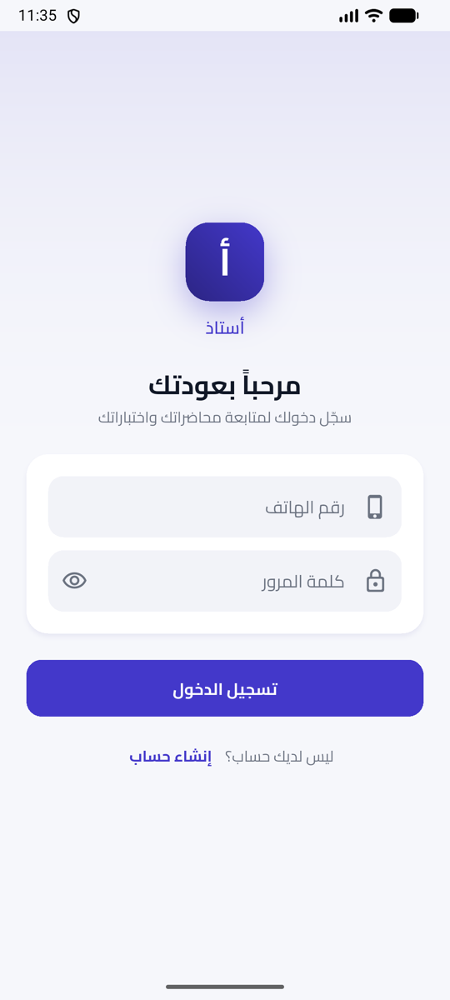
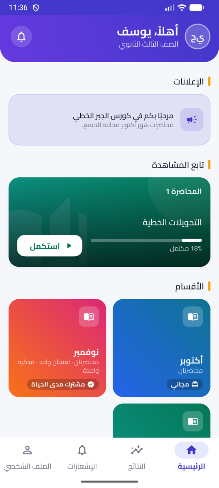
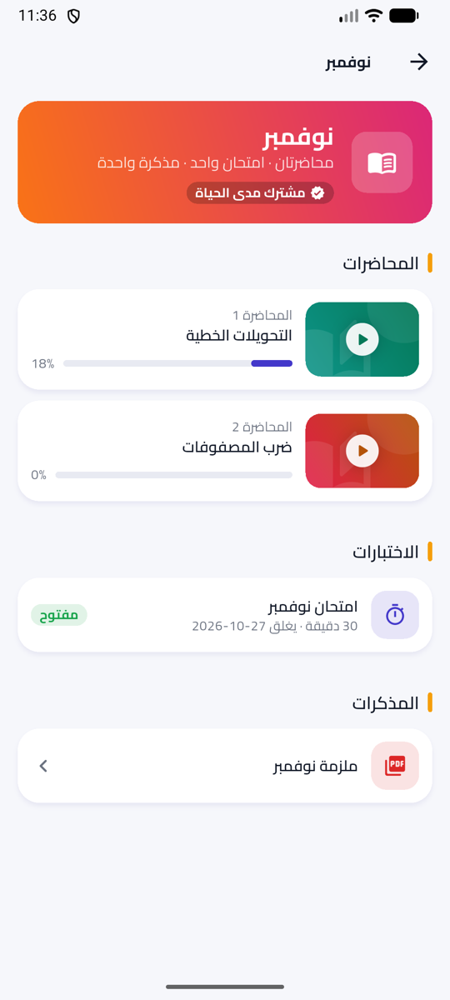
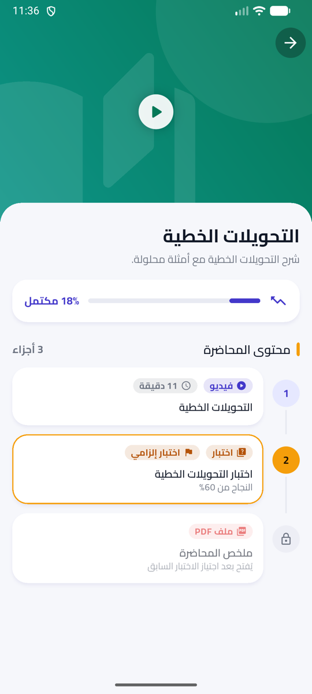
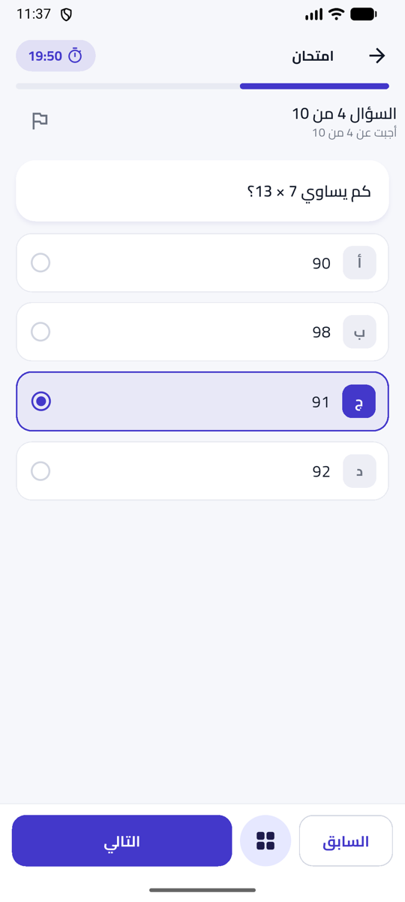
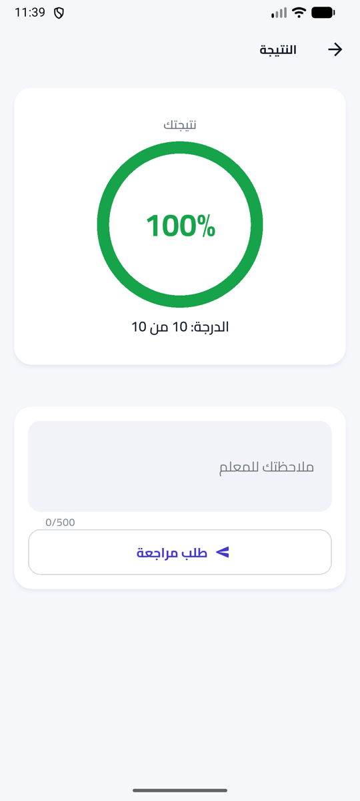
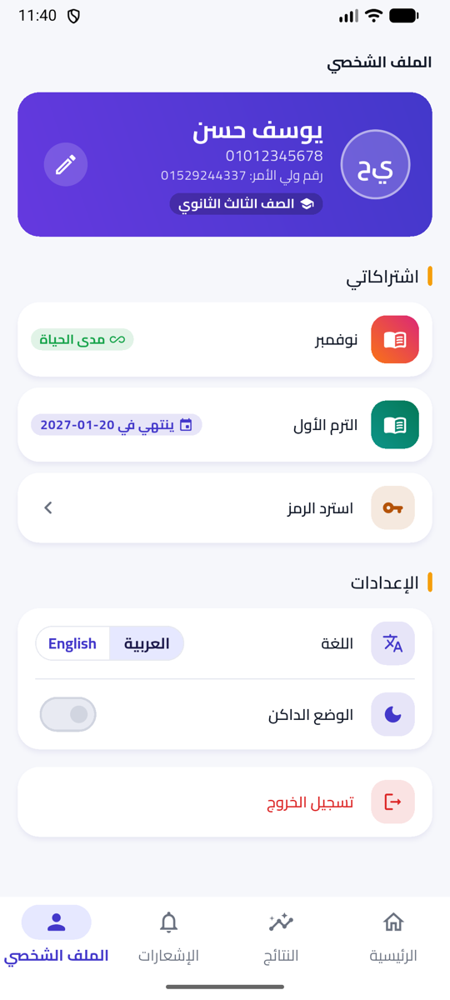
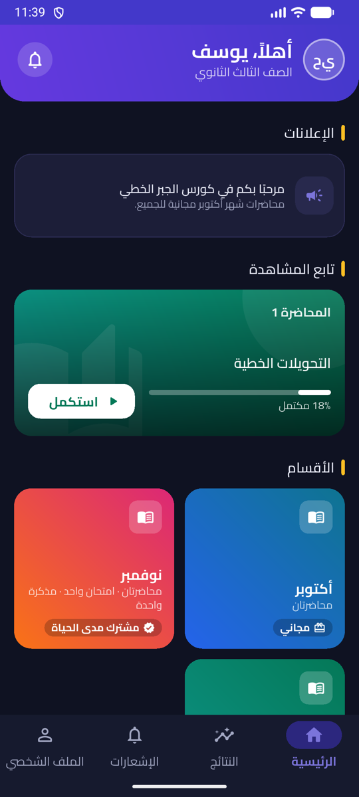

# Ustaz

[العربية](README.md) · **English**

An open-source tutoring platform for **one private teacher**: a Flutter student app and a Laravel + Filament
panel for the teacher. Arabic-first (RTL), English as a second language.

Students watch lectures, take gated quizzes and timed exams, and redeem activation codes. The teacher publishes
content, sells access per monthly or term package, follows who watched what and who passed, and answers review
requests — from one panel.

## Repository

| Path | What |
|---|---|
| [`backend/`](backend) | Laravel 13 API and Filament 5 teacher panel |
| [`app/`](app) | Flutter student app |
| [`docs/`](docs) | Design spec, implementation plans and the [API contract](docs/api-contract.md) shared by both sides |

## Backend

- Filament panel for content, question bank, exams, students, activation codes, review requests,
  analytics and push notifications, with teacher and assistant roles.
- Sanctum token API with one bound device per student, subscription and gating-quiz locks, server-side exam
  deadlines and automatic re-scoring when a correct answer changes.
- Tagged cache on every hot read, queued jobs for slow work, and Redis or plain database drivers chosen in
  `.env` — it runs on a VPS or on cheap shared hosting.
- Pest test suite, including a load smoke test on the demo data.

Five-minute local setup, demo accounts and production notes: [backend/README.md](backend/README.md).

## App

- Flutter and GetX, Android and iOS, Arabic (RTL) and English; every screen shares the same loading, empty
  and error states.
- Gated lectures with video, PDF and quiz segments; timed exams that follow the server deadline, keep answers
  through network drops and resume after the app is killed.
- Content protection: one device per student, `FLAG_SECURE` on Android, video paused while the iOS screen is
  recorded, and a moving watermark with the student's name and phone.
- Rebranded for a teacher from one config file and the platform ids; Firebase push is optional.

Run it against the demo backend, rebrand it and enable push: [app/README.md](app/README.md).

| Login | Home | Category | Lecture |
|---|---|---|---|
|  |  |  |  |
| **Exam** | **Result** | **Profile** | **Home, dark mode** |
|  |  |  |  |

## License

[MIT](LICENSE) © 2026 Mohamed Nait Merri
